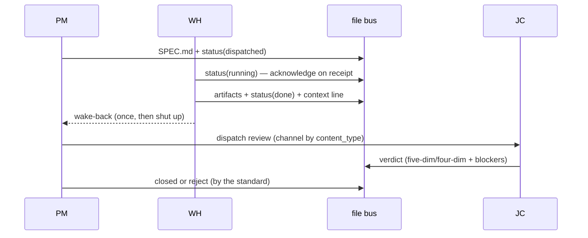

Fact sources: measured on disk (the full task-bus tree + /shared/docs/AGENTS-common.md §9.x + the ops-doc series proposal-ops11/17/19/20) + phase-one drafts (/shared/projects/_writing/tasks/t-20261119-techdoc/staging-v1-drafts/04, 05, respective pieces)

> Note: paths are reproduced as-is; Chinese directory names are literal.

# §5 Collaboration Mechanisms (the Copyable Part)

The heart of the article. What this section answers: the minimal mechanism set a reader can copy outright. Each subsection runs incident first, then mechanism, then a quick-reference box (the full quick-reference boxes are the five pieces under staging-v1-drafts/04-速查表/; only the conclusion lines appear here).

## ① File bus: the only channel is files, not messages

Incident first: in the stale-snapshot replay event, the same task's "current state" came out in three versions from three sources (full investigation in staging-v1-drafts/05-调查记录/01-旧快照重放三源调查.md). Messages get lost, arrive out of order, and vanish on restart; "I remember" inside a session is a snapshot, and snapshots go stale.

Mechanism: the only cross-agent channel = files. Directory skeleton:

```
/shared/projects/<proj>/
├── tasks/<task-id>/
│   ├── SPEC.md        requirements + acceptance
│   ├── context.md     handoff ledger (append-only, one event per line)
│   └── status.json    state machine (the sole authority)
└── reviews/           review records
```

Files have mtime, an owner, and a byte count; the terminal state is unique. Messages can be replayed; files do not lie — the hardest of the three rules ①②③.

> Project-based directory layout (solves the trunk skeleton and archiving rules for the ops file bus). This proposal carries no specific text; see attachment [A-ops3](../attachments/ops3-o-and-m-layout.md).

## ② context.md: seven elements + whoever signs writes

One JSON per line: `ts/from/to/task/action/payload/trace` (note optional). Three rules: whoever signs writes (the signing party writes its own line; nobody writes it for them); appends only via `>>`, and an overwrite starts with a `cp` backup; writes use a tmp file in the same directory plus an atomic `mv` replacement.

Incident first: a tmp file in a different directory (say /tmp) makes mv land with a drifted owner-group (measured here: 664 group 2002 drifted to primary-group 1002, downstream appends then refused — three regression tasks on this cluster kept stepping on it on 2026-11-19). Timestamps must be taken from the actual instant of writing — no pre-writing, no backfilling from memory — a hardcoded started_at from memory drifted by 22 seconds and was caught red-handed by close-out reconciliation (measured on this cluster 2026-11-19, source = the task's context-vs-status reconciliation lines).

## ③ Sub-session splitting: the 80% rule and its limits

When the main session's context reaches 80%, force a sub-session: write a handoff document, then cold-start. Measured basis: with the PM main session at 118k/128k, about 92%, single turns run 90-110 seconds (source = main workspace memory, 2026-11-17); at 92%, one full review round needs two or more waits hanging over it — that is the entire rationale for splitting.

The limitations must be copied too: a sub-session has no outward channel. It cannot notify third parties for you; results can only return to the dispatching party for close-out. Whoever designs this mechanism without knowing that will design the dead path of "the sub-session goes to nag another agent."

## ④ Three-layer watchdog + watching the watcher

The three layers in one line each: process heartbeat (heartbeat.log), task-level timeout (idle with no action becomes an event), off-disk action inspection (state-probe class). In v1 this subsection told the 21-minute missed-alarm incident and the v20 baseline details; in archive v2 all of that is handed over to the §6 watchdog full-pipeline chapter — that chapter has the complete six rings from plan review to rollback, an order of magnitude more detailed than the survey here. This section keeps only the conclusion line: **every ring of a bark needs on-disk evidence; an event without a log is an event that never happened**; watching the watcher (who reviews the dog, how the dog gets rolled back) is in §6 rings ③⑤.

> Sniff-watchdog minimal viable implementation (the smallest version that gets the dog from zero to running). This proposal carries no specific text; see attachment [A-ops11](../attachments/ops11-sniff-watchdog-mvp.md).

> Per-node time budgets and whole-project time control (solves one task dragging the whole pipeline to death). This proposal carries no specific text; see attachment [A-ops15](../attachments/ops15-node-watchdog.md).

> Watchdog closed-loop repair (solves the broken seven-ring chain: detect → alert → escalate → respond → fix → verify → close). This proposal carries no specific text; see attachment [A-ops16](../attachments/ops16-watchdog-loop.md).

> Three-level escalation watchdog (solves the graded escalation sniff → in-business → full probe → intervene). This proposal carries no specific text; see attachment [A-ops17](../attachments/ops17-three-level-watchdog.md).

## ⑤ Permission model: 2775 / 664 / 644 / group 2000, zero ACL

Mechanism: directories 2775 (setgid preserves group inheritance), collaboration files 664, read-only ledgers 644, everything owned by group 2000. No ACLs, no exception tables.

Closing with a counterexample (permissions are not convention, they are a defense line): 2026-11-19, on this very task, the docs subtree was re-imported from outside by root as root:root 755 — five already-delivered body chapters were cleared to the root, and the executor could not write. The forensic file is on disk (staging-v1-drafts/forensic-docs-tree.txt, recording the owner state at the scene); the drafts had been moved into staging-v1-drafts/ in advance, so there was no total loss. The recovery action itself twice flushed files back to root:root 755 — the same hole stepped in three times across two days. Conclusion: permission fields are the last defense line of data integrity; any "sync/deploy" action must be stat-checked on the spot after landing — do not wait for the next refused write to find out.

The gate (Owner baseline, 2026-11-19 20:16): any action against the ops intervention surface (pjw) — stop/reset/wake/nudge/file edits — must first run pjw-gate.py: if dog-watch.log has a "bark#" line within the last 10 minutes, exit=0 releases; otherwise exit=2 forbids. No run without review; no intervention without a bark.


The second counterexample (2026-11-22, a live record from this archive task itself): one cross-directory `tmp+mv` atomic write carried the file's group from the inherited group to the source directory's group (1002), and a downstream session's append to the 644 file was refused outright. The three-line scene account is in context.md (AR-02-04/05/06), and the fix is two commands: `chgrp -R 2000` + `chmod 664`. The lesson enters the SOP as one line: **after any cross-directory mv, always check stat** — permission fields are defense lines, and they are fields that drift; even the act of "fixing permissions" must itself be booked and traced.

## ⑥ The anti-ghostwriting red line

The signing party writes its own lines. Exactly one exception: the Owner names it explicitly and the source is labeled. main holds full ops authority yet never ghostwrites signed content (§3 table, ops-loop main row). This is not a style question, it is a bookkeeping question: once signature and writing are separated, the from field in context loses its forensic value.

## Conclusion of this section

The value of mechanisms is "when things go wrong, the books are still there." Each of the six above maps to a real incident; when you copy this, copy the incidents along with it — that works better than copying only the configuration.

How to verify: re-read the SPEC/context/status trio from any task directory in the task tree; for the dog baseline re-read SOP §7.2/§7.2.1 and the header comments of dog_watch v20; for the permission baseline run `stat -c '%U:%G %a'` on any shared file.


## Figure: one complete dispatch chain (rendered version)



Text equivalent: PM writes SPEC and dispatched → WH first acknowledges running (respond on receipt, do not queue) → WH delivers artifacts, writes done + the context line → wakes PM once then ends (one-way notification and silence) → PM picks the channel by content_type and dispatches JC → JC's verdict lands in reviews/ → PM closes out or rejects. Nowhere does any of it rely on session memory.

Self-check: the redaction grep yields zero hits in this section (the real intervention-surface name has been generalized to the pjw baseline and kept — it is a mechanism name, not an entity name; entity names such as a certain IM have been generalized); verification four rules: this section touches the relocation red line — the docs incident is written as "externally re-imported and cleared," with no relocation narrative, compliant; logic-chain elements complete (what it answers: the copyable mechanism set; conclusion: the books are still there; material pointers: ops11/17/19/20, AGENTS-common, the five quick-reference boxes); overlap with §9 handled: this section tells the story and gives conclusions; the six-family table appears only in §9, cross-referencing without retelling.

## Before copying, align on three premises

This mechanism set is not plug-and-play; landing it carries three implicit premises, and missing any one warps it. First, you yourself are willing to be governed by the process too — the Owner's intervention surface has its gate as well (⑤); a process has credibility only when it applies to everyone, and a process that constrains only the AI while exempting the human gets dismantled by your own people in week one. Second, your team size is at least two automated roles plus one human decision-maker; with a single agent, the file bus and the trio are pure overhead — cut straight to steps 1+6 of the §10 checklist. Third, accept a slow start: the first two weeks of mechanism-building produce nothing; output begins only after the week-three gate tests all run green. None of the three is a technical problem, but if any one fails, the mechanism will regress.

## Acceptance actions per subsection (built into this section)

① File bus: `stat` the trio of any task in a row of three — mtime monotonic and content consistent. ② context: sample one line — seven elements complete, signature matching the from field. ③ Sub-session: the handoff document can cold-start and resume a task. ④ Dog: stay silent manually for 9 minutes and watch whether the forced bark triggers. ⑤ Permissions: `stat -c '%U:%G %a'` on any file lands on the baseline; the gate script dry-run on both branches (bark → released / no bark → forbidden). ⑥ Ghostwriting: sample three signed files — the signing party and the writing session match. Six greens, and §5's mechanisms count as standing on your disk — miss one, and the missing one will tutor you in the next incident.
