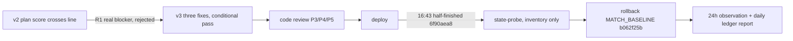

Fact sources: /shared/projects/_ops/reviews/dogwatch-phase1-v2-review.md + dogwatch-phase1-v3-review.md + review-dogwatch-phase1-patch-20261121.md + /shared/projects/_ops/tasks/_ops/dogwatch-rollback-20261121.md + dogwatch-state-probe-20261121.md + the /shared/projects/_ops/dog/ scene (bark-ledger.jsonl/self-baseline.sha/heartbeat.log) + discussion-handoff/materials/_supplement-discussion-summary-20261121.md (cited below as sup) §1.5-6 + HANDOFF-20261122-pm-summary.md §3.3

> Note: paths are reproduced as-is; Chinese directory names are literal.

# §6 The Watchdog Deployment, Start to Finish

What this section answers: how a "guard process" runs the complete chain of plan review → code → deployment → inventory → rollback → observation. This is where every mechanism in the article first spins in full on a real ops intervention surface — each discipline told in §5 has a numbered proof-of-record in this chapter.

## The six rings

**Ring ① the plan gets rejected.** The dogwatch v2 plan went to review; its score crossed the line, and it was still sent back. Real blocker R1: the update step of the self-hash baseline had no deployment-time stage, so the moment the dog came online its baseline would mismatch — "the dog comes online and immediately alarms on itself" (v2-review, the R1 section). A textbook case of §4 iron rule ②: the blocker gate outranks the score gate.

**Ring ② all three fixes accepted, conditional pass.** v3 accepted three fixes: the baseline externalized as self-baseline.sha, the deployment steps hardcoded in a fixed order, and the self-test cases completed. The re-review score met the bar: conditional pass (v3-review closure table: R1 crossed off item by item).

**Ring ③ code review, cases verified one by one.** After the code landed it passed code review: six test cases read against each other one by one, plus three improvement items P3/P4/P5 required fixed before deployment; the declared edge case (item F) was ruled "not blocking, keep under observation" (patch-review §2).

**Ring ④ a half-finished state appears — inventory only, hands off.** At 16:43 an intermediate state inconsistent with the baseline appeared on disk (current value 6f90aea8 ≠ baseline ≠ backup; three values mutually unequal). The response was not "fix it while I'm at it": produce one probe file, inventory the six-hunk diff item by item, modify nothing, propose nothing, await adjudication (the state-probe file). The execution form of §4 iron rule ③.

**Ring ⑤ rollback, hash three-value comparison.** At 17:16 rollback to baseline, receipt MATCH_BASELINE: the hashes before and after rollback compared — before (the 16:43 half-finished state) 6f90aea8; after = baseline requirement = b062f25b; the .bak backup file's hash, 2b99da36, differs from the baseline, which is normal (the backup preserves the older content from that moment). The settlement rests on the pair "post-rollback current value = baseline" (the comparison table in the rollback file). The second forensic posture is established here — beyond mtime, sha256 baseline comparison can also settle cases (§7's forensics method cites this spot).

**Ring ⑥ observation period.** 24 hours of post-deployment observation plus a daily ledger report: bark-ledger.jsonl (7.5MB as of 11-22 10:02, an actively growing file whose exact byte count changes constantly; event by event), heartbeat.log, the daily report files; pre-written initialization events do not bark; recurrence only gets upgraded within a 24h recurrence window. The grading line was given as conditional pass by om-jc's second review; the grading disagreement was reported to the Owner, who signed off the downgrade to L2 — the criterion sits in the institution, the grading sits with the human (sup §1.5-6, HANDOFF §3.3).

## Three bugs, all old lessons in new skin

1. **notify fails silently**: notifications went through Popen without shell=True; under Windows a .cmd is not executable and throws, while the except branch is a pass — the exception is swallowed, the dog barked but nobody was woken. `except pass` is the code form of silent failure, kin to §5's "nobody knows whether the message went out" (sup §1.5).
2. **Bark spam during silence windows**: SILENCE_BARK_SEC only checks "how long since last," not "is the event still alive" — while the same event persists, it barks repeatedly on the time window. The monitoring criterion was missing the liveness dimension (sup §1.6).
3. **The popup**: using both window flags at once makes Windows simply ignore one of them, and the popup breaks out. The previously set "CREATE_NO_WINDOW single flag" baseline was corrected to pick-one (HANDOFF §3.3, verified against MSDN).

## Benchmarked against industry

The three noise-reduction pieces are isomorphic with industry: event-key dedup plus a four-hour digest (the Alertmanager route), the 24h recurrence window, and fail-open — better too many than none (watchdog-industry-research.md, _review-dog-rules-20261120.md). The difference is not in the tools but in the order: we got bitten by the dog before adding noise reduction, while industry documents give only the conclusion, never the bite marks.

## Why this chapter earns its full length

The dog is the "last referee" for every mechanism in the article — timeouts, lost contact, off-disk actions all fall to its bark. This chapter proves the referee itself passed three gates: plan review (rejected for R1), code review (P3/P4/P5), and operational review (its finished product probed by state-probe). "Watching the watcher" is no longer a slogan but an evidence chain with hash values.

**How to verify**: three review files in /shared/projects/_ops/reviews/, two inventory files in /shared/projects/_ops/tasks/_ops/; `stat /shared/projects/_ops/dog/bark-ledger.jsonl` for the byte count; the hash comparison table in the rollback file is recomputable (sha256sum of dog_watch.py's current value should equal baseline b062f25b).

> Dog-ecosystem sync paired with heal repairs (solves dog ↔ business/ops-lane coordination). This proposal carries no specific text; see attachment [A-ops14](../attachments/ops14-dog-sync.md).

> Project-based watchdog lifecycle (the full cycle: release the dog → find the dog → walk the dog home). This proposal carries no specific text; see attachment [A-ops18](../attachments/ops18-project-watchdog-lifecycle.md).

> Watchdog reliability hardening and notification channels (solves alerts that can't be sent or don't arrive). This proposal carries no specific text; see attachment [A-ops19](../attachments/ops19-dog-watch-reliability.md).

> Dog integrity enforcement (solves SOP-bypassing-the-dog events). This proposal carries no specific text; see attachment [A-ops20](../attachments/ops20-dog-integrity-enforcement.md).

## Figure: the dog evolution chain (rendered version)

Text equivalent: the v2 plan's score crossed the line yet was rejected for real blocker R1 → v3 accepted the three fixes for conditional pass → code review fixed P3/P4/P5 → deploy → at 16:43 a half-finished state appears (the three hash values mutually distinct) → the probe file inventories without touching → post-rollback current value fully equals baseline b062f25b → 24 hours of observation and daily reports. One file per ring, no actions outside the rings.

Self-check: the redaction grep yields zero hits in this section (process names/hashes/paths are all on-disk public file names; no host usernames or addresses); verification four rules not touched in this section (all 11-21 measurements); the AI-writing word-list grep yields zero hits in this section; logic-chain elements complete (what it answers: the guard process's full chain; conclusion: one file per ring, inventory-only is the default response; material pointers: three reviews + rollback + state-probe + the dog/ scene + sup §1.5-6 + HANDOFF §3.3).
