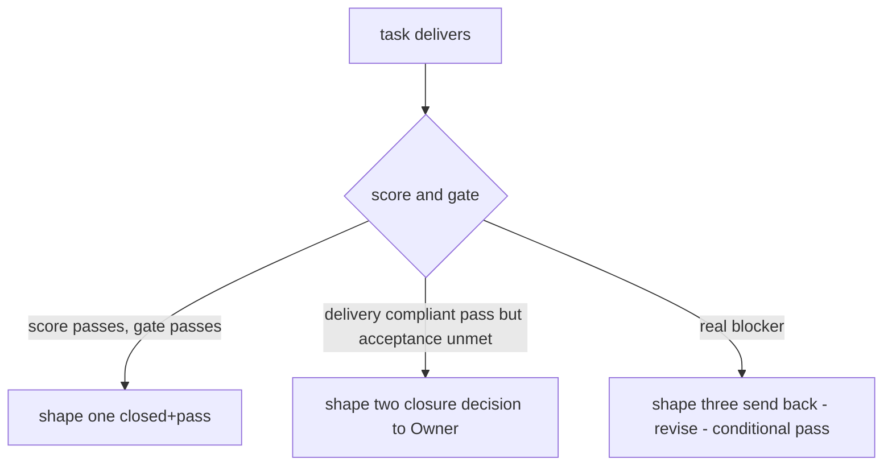

Fact sources: ops docs (/shared/docs/AGENTS-common.md §9.2/§9.8/§9.9) + measured on disk (the full L3-01 chain: context/status/reviews) + phase-one case drafts (staging-v1-drafts/06, 05-02, 07-01)

> Note: paths are reproduced as-is; Chinese directory names are literal.

# §7 How Review Closes Out

What this section answers: how to decide "it passed" — with a verdict that is recomputable. This chapter is the core of the whole system, so the writing mode changes: the structure and the why are explained fully, but **the specific weights, thresholds, and condition lists are internal institutional matters and do not enter the public draft** — you will know this machinery exists and know why it is designed this way, but you cannot reconstruct the scoring table from this chapter alone.

## ① The scoring table: structure only

Five dimensions on the article channel, four on the code channel; the weight allocation lives in the internal scoring table, and this article gives only the structure: each dimension corresponds to one failure mode. A score distribution skewed too far toward one dimension (grading only the prose, say) means the review targeted the wrong object — review again. Release lines are set per level; the specific thresholds are internal institutional matters.

## ② Anti-drift: an independent gate, not inside the score

Anti-drift is not a scoring dimension; it is an independent gate: no matter how high the total score, failing anti-drift is a direct fail. What it blocks is "the content is great but the process was broken" — process violation is the most expensive class of error in a distributed system. The category list (six classes: level / stage / permission / signature / record / drift) is in AGENTS-common §9.8.

## ③ The sign-off exemption channel: the last step of dismantling "me" into institution

The rule itself (AGENTS-common §9.9, set by the Owner on 2026-11-18): when multiple unconditional passes plus a full anti-drift score are met, landing may proceed without the Owner's signature, with a post-facto filing; the specific conditions are internal institutional matters. The first case, L3-01 (landed 2026-11-18): the outcome field name in status.json is itself the case number, and the full chain can be re-read in the corresponding directory under /shared/projects/_test/tasks/. Three boundaries to know together: exemption is not waiver of review; a reviewer writing a "recommend future attention"-style reservation = conditional release, treated the same as fail; after landing, filing is mandatory — a post-facto notice is not a non-report. The signature gate was once the longest wait at the highest level (the Owner as single point); after the exemption dismantled it, that L3 task ran from dispatch to closure with zero signature wait.

> Codifying the first failure's root cause (solves stepping in the same hole twice). This proposal carries no specific text; see attachment [A-ops7](../attachments/ops7-codify.md).

> p28 SPEC v2 resumption and scoped execution (solves how a stopped task resumes compliantly). This proposal carries no specific text; see attachment [A-ops8](../attachments/ops8-p28-resume.md).

> Master Proposal consolidated fix pack (solves the disorder of parallel proposals; merges ops7/8). This proposal carries no specific text; see attachment [A-ops9](../attachments/ops9-master.md).

## ④ Fixture isolation: controlled experiments must not pollute the quality counts

Test artifacts written wrong on purpose (to exercise the rejection loop) would trip the brake line with their own drill if they counted toward the reject counter. Countermeasure: fixture tasks are booked locally, the global count stays untouched, and the whitelist baseline keeps a credential line — the adjudication conditions are internal institutional matters (§9.2.1).

> Fixture-isolated counting baseline and filing-permission addendum (solves controlled experiments polluting quality counts). This proposal carries no specific text; see attachment [A-ops12](../attachments/ops12-fixture-counter-perms.md).

## ⑤ The brake line and the sole authority for the count

The reject count has a single authoritative source (a sole-writer file); no session's narration constitutes count authority; the specific files and forensic methods do not enter the public draft. One qualitative rule: when narration conflicts with the disk, trust the disk — in the "0 vs 2" case, one zeroing had hard proof and one was a stale-baseline write-back; the two mechanism accounts were kept separate.

## The three close-out shapes (v2 cases)

The historical terminal-state inventory is in internal records. The three shapes themselves are public:

- **Shape one: score passes + close** — two clean review rounds pass outright and the task closes (the discussion-summary case).
- **Shape two: delivery compliant (pass) but acceptance not met → the closure decision goes to the Owner** — "pass" and "target not met" stand simultaneously and cancel neither; the act of "closing out" itself also runs through the review channel (the close-out of the close-out).
- **Shape three: sent back → revised → conditional pass** — the score crossed the line yet the task was sent back for a real blocker; after revision, conditional pass (the dogwatch chain; §6 rings ①②③ are its execution surface).

One new case: **a prediction can be falsified while the delivery still passes** — the reviewer's prediction missed on re-run, which did not affect the delivery verdict, because the criterion is recomputed numbers, not predictions (the kb case). Two forensic postures: mtime settles sequence, sha256 three-value baseline comparison settles content (§6 ring ⑤).

## Figure: the three close-out shapes (rendered version)

Text equivalent: a delivery first faces two bars, the score and the gate: both pass → shape one, closed directly; delivery compliant but below the acceptance line → pass and "target unmet" coexist, the closure decision belongs to the Owner; a real blocker present → the send-back, revise, re-review path ending in conditional pass. The close-out act common to all three shapes is itself inside the review channel.

Conclusion of this section: the last step of "dismantling 'me' into institution" is the sign-off exemption — even the human is no longer required, yet the filing still stands, and the books are still on disk.

How to verify: pick any historical close-out, re-read the four fields of its status.json and its review files, and check whether the verdict and the numbers match and recompute; for the exemption case, re-read L3-01's three review records.

Self-check: the redaction grep yields zero hits in this section; the threshold numbers have been fully extracted (see the context list); verification four rules: the conclusion line "dismantling 'me' into institution" echoes the master-structure doc, and Vera (future-facing) is not touched in this section; logic-chain elements complete (what it answers: recomputable verdicts; conclusion: sign-off exemption = the institution's end state; material pointers: AGENTS-common §9.x / ops7/8/9/12).
